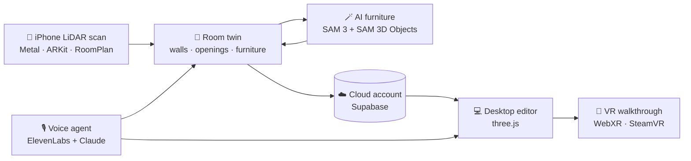

<div align="center">

# 🏠 RoomTwin

### Scan your room with an iPhone. Redesign it with your voice. Walk through it in VR.

**A real-time digital twin of any room, from a LiDAR scan to a furnished, walkable, editable 3D space.**

[](LICENSE)
[](#-on-the-iphone)
[](#-on-the-desktop-and-in-vr)
[](#-under-the-hood)
[](#-under-the-hood)

[Features](#-features) · [How it works](#-how-it-works) · [Getting started](#-getting-started) · [Tech stack](#-tech-stack) · [License](#-license)

</div>

---

## ✨ What is RoomTwin?

Redecorating means guessing: Will the sofa fit? Does walnut go with these walls? What would the room
feel like with the desk by the window?

**RoomTwin takes the guessing out.** Walk round a room with a LiDAR iPhone and in a minute you have
a true-to-scale 3D twin of it: walls, doors, windows and every piece of furniture. Then change it however you like:

> 🎙️ *"Add a leather sofa by the wall, put a lamp on the table and make the floor oak."*

…and it happens, in the scanned room, at real size, without things going through walls. Open the same room on your
PC, put on a headset and **walk round the new layout before you move a single chair.**

---

## 🚀 Features

### 📱 On the iPhone

| | |
|---|---|
| ⚡ **Real-time LiDAR reconstruction** | A GPU mesh that builds up live over the camera view, written in Metal from a peer-reviewed research paper ([Dong et al., ICRA 2018](#-under-the-hood)). |
| 🧱 **Room Layout with RoomPlan** | Clean walls, doors, windows and labelled furniture, each piece swapped for a matching 3D model. |
| 🔀 **Hybrid scanning** | Detailed coloured mesh *and* clean RoomPlan structure from one AR session, at 30 FPS. |
| 🪄 **AI furniture replacement** | Meta's **SAM 3** finds each piece of furniture and **SAM 3D Objects** rebuilds it as a full 3D model, back included. |
| 📸 **Photo → 3D object** | Tap an object in one photo and get a 3D model of it, sized from LiDAR depth, in about 30 seconds. |
| 🌀 **Walk Around capture** | Apple Object Capture turns a walk round an object into a textured model, entirely on the phone. |
| 🖐️ **Hand-tracked AR editing** | Pinch furniture in mid-air and move it around the real room. |
| 🖥️ **Mac companion** | Swipe a model up on the phone and it flies onto your Mac's screen. |

### 💻 On the desktop and in VR

| | |
|---|---|
| ☁️ **Your rooms, everywhere** | Log in and the room you last scanned on your phone opens with the phone's edits. |
| 🛋️ **Furnish freely** | Search thousands of models from Poly Haven and Sketchfab, or drop in your own. |
| 🎯 **Real-world physics** | Furniture collides with walls and other pieces, can't leave the room, and snaps to walls and surfaces. |
| 🎨 **Restyle the room** | Real-scale textures on walls and floors, materials on furniture, lighting brightness and warmth. |
| 🕹️ **Pro editing tools** | Blender-style move, turn and stretch handles, undo and redo, duplicate, and keyboard shortcuts. |
| ✋ **Webcam hand control** | Move furniture with your hand in the air, tracked on your own computer. |
| 🥽 **Step inside in VR** | Walk round your redesigned room in any SteamVR headset, and grab furniture with the controllers. |

### 🎙️ Talk to your room, everywhere

One conversational agent works on the phone and on the PC, and understands the room it's in:

- *"Add a chair facing the desk"*
- *"Make the walls red brick"*
- *"Move chair 2 to the left"*
- *"Make the room warmer and brighter"*
- *"Replace the sofa with a leather one"*
- *"Hang a ceiling light"*

Every spot is checked before anything is placed. If a wall, a table or an earlier piece is in the
way, the piece moves to the nearest clear floor, and if there's no room, the agent says so.

---

## 🧠 How it works



1. **Scan.** LiDAR depth is fused on the GPU into a mesh that updates as you move. RoomPlan adds
   the structure: walls, doors, windows and labelled furniture.
2. **Understand.** Walls, floor and free space are worked out from the scan, so new pieces stand
   on real floor and back up to real walls.
3. **Rebuild.** Scanned furniture becomes editable 3D models, from a matching library model or
   rebuilt by SAM 3D Objects from the scan's photos.
4. **Redesign.** Edit with touch, hands, keyboard or voice. Every move is checked against the room.
5. **Experience.** Rooms sync through your account to the desktop app, and from there into VR.

---

## 🔬 Under the hood

RoomTwin's live scanner implements the mesh representation from **Dong et al.,
*An Efficient Volumetric Mesh Representation for Real-time Scene Reconstruction using Spatial
Hashing* (ICRA 2018)**, in Metal:

- **Spatial hashing.** Space is split into 8×8×8 blocks of cubes, allocated only near surfaces.
- **Mesh stored in the volume.** Each vertex is stored once and found with a single hash lookup.
- **Incremental meshing.** Only the blocks the current frame touches are remeshed.
- **GPU memory pools.** The pools are drawn directly, with no per-frame mesh extraction.
- **Lock-free.** Vertices are claimed with compare-and-swap instead of the paper's per-vertex locks,
  because Metal doesn't guarantee spin locks make progress.

Its correctness is checked headlessly on a Mac GPU. The checks cover one vertex per edge, exact
reference counts, no leaks, and a manifold mesh with consistent winding.

---

## 🛠 Tech stack

<table>
<tr><td><b>iPhone & Mac</b></td><td>Swift · SwiftUI · Metal · ARKit · RoomPlan · Object Capture · Vision · Multipeer Connectivity</td></tr>
<tr><td><b>Desktop & VR</b></td><td>TypeScript · three.js · WebXR · Vite · Tailwind CSS · MediaPipe</td></tr>
<tr><td><b>AI</b></td><td>Meta SAM 3 · SAM 3D Objects · ElevenLabs Conversational AI · Claude</td></tr>
<tr><td><b>Cloud</b></td><td>Supabase (auth, Postgres with row-level security, storage)</td></tr>
<tr><td><b>3D content</b></td><td>Poly Haven (CC0) · Sketchfab (CC BY)</td></tr>
</table>

---

## 🏁 Getting started

### Requirements

- **iPhone or iPad with LiDAR** (iPhone 12 Pro or later Pro, or iPad Pro), Xcode on a Mac
- **Windows PC** (or any computer) with Node.js and pnpm. A SteamVR headset is optional.

### 1. Configure

Create a `.env.local` at the top of the repo. It's git-ignored and never committed:

```ini
SUPABASE_URL=...
SUPABASE_ANON_KEY=...
ELEVENLABS_API_KEY=...
ELEVENLABS_AGENT_ID=...
SKETCHFAB_API_TOKEN=...      # optional
```

### 2. iPhone app

1. Open `ios-mac/RoomTwin.xcodeproj` in Xcode.
2. Pick your team under **Signing & Capabilities**.
3. Run it on your phone.

### 3. Desktop app

```sh
cd windows
pnpm install
pnpm dev        # → http://localhost:5173
```

On Windows you can also double-click `windows/RoomTwin.cmd`. For VR, start SteamVR first, then
click **Enter VR**.

> **No phone yet?** Click **Test room** or **Test RoomPlan** in the desktop app to try everything on
> a sample room.

---

## 📂 Project structure

```
RoomTwin/
├── ios-mac/     iPhone scanner, Metal reconstruction, Mac viewer, AI pipelines
└── windows/     Desktop editor and VR app
```

---

## 🔐 Privacy & security

- Your scans and objects are stored privately: Postgres row-level security means each account can
  only see its own.
- API keys stay on your machine. The phone and the browser only ever get public, restricted keys.
- Hand tracking runs on the device. Camera frames never leave it.

---

## 🤝 Contributing

Contributions are welcome! Open an issue to discuss an idea or report a bug, or send a pull request.

---

## 📜 License

RoomTwin is open source under the [MIT License](LICENSE).

3D models from [Poly Haven](https://polyhaven.com) are CC0. Models from Sketchfab keep their
authors' CC BY licences, and the app shows their credits.

<div align="center">

**Built with ❤️ by [tysuprawee](https://github.com/tysuprawee) and [ishaan1234](https://github.com/ishaan1234)**

*If RoomTwin made you rethink your living room, give it a ⭐*

</div>
